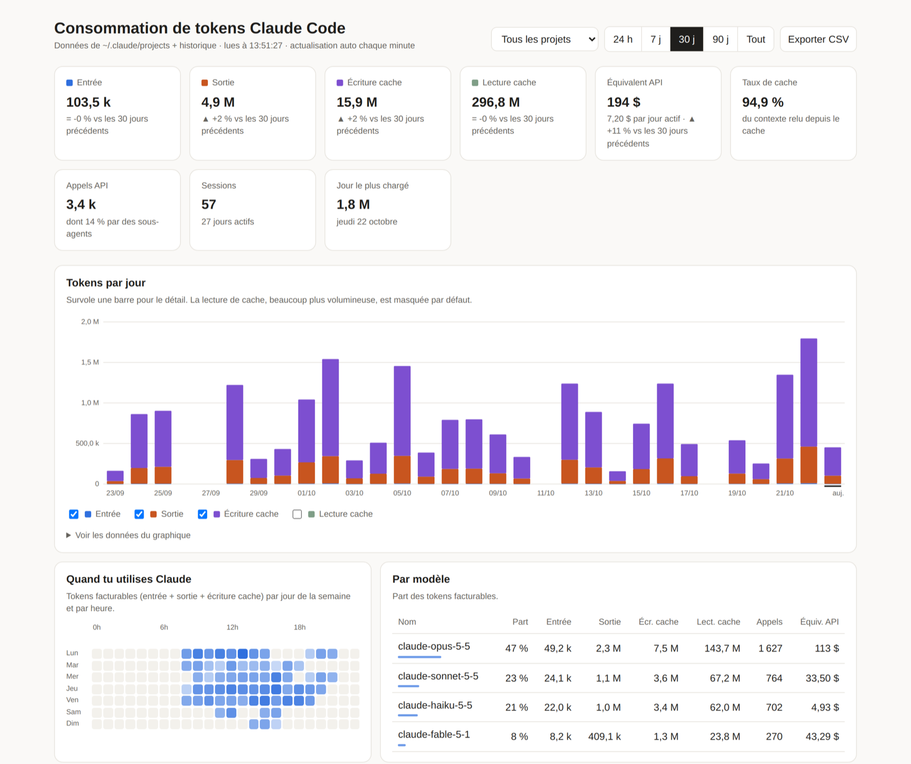

<div align="center">

# Token Follow

**Tableau de bord local de ta consommation Claude Code : tokens, cache, forfait, et ce que ça coûterait au prix de l'API.**

[](https://github.com/EXOSTE/claude-code-usage-dashboard/actions/workflows/install.yml)


[](LICENSE)

<picture>
  <source media="(prefers-color-scheme: dark)" srcset="docs/apercu-sombre.png">
  
</picture>

<sub>Données fictives, générées par <code>npm run demo</code>.</sub>

</div>

## Pourquoi

Claude Code n'affiche pas ce que tu consommes au fil des jours. Pourtant chaque appel est noté dans `~/.claude/projects`. Token Follow lit ces journaux et te montre :

- **combien de tokens** tu utilises par jour, par modèle, par projet et par session, comparé à la période précédente ;
- **l'équivalent en dollars au tarif de l'API**, utile pour juger ce que ton abonnement t'apporte ;
- **ton taux de cache**, la part des sous-agents et tes sessions les plus gourmandes ;
- **quand tu travailles**, avec une carte de chaleur jour × heure ;
- **l'utilisation de ton forfait** (limites de 5 h et de 7 jours), tous produits Claude confondus, Cowork compris.

> **Et Cowork ?** Son usage apparaît dans la courbe du forfait, en pourcentage, mais **pas en nombre de tokens** dans la plupart des cas. Détails dans [Cowork : ce qui est suivi](#cowork--ce-qui-est-suivi).

Et trois choses qu'on apprécie vite :

| | |
|---|---|
| 🔒 **100 % local** | Le serveur n'écoute que sur `127.0.0.1` et n'envoie rien nulle part. Aucun compte, aucune clé API. |
| 🗂 **Rien ne se perd** | Supprimer une session dans Claude efface son journal. Token Follow garde sa propre copie de chaque appel, pour que tes stats survivent. |
| ⚡ **Une commande, zéro dépendance** | Node 18 suffit. Pas de `node_modules`, pas de base de données, pas de build. |

## Essayer en 10 secondes, sans rien installer

```bash
git clone https://github.com/EXOSTE/claude-code-usage-dashboard.git
cd claude-code-usage-dashboard
npm run demo
```

Le tableau de bord s'ouvre sur des données fictives (60 jours, cinq projets). Tes vrais journaux ne sont pas lus. `Ctrl+C` pour arrêter.

## Installation

Il te faut [Node.js](https://nodejs.org) 18 ou plus récent.

```bash
git clone https://github.com/EXOSTE/claude-code-usage-dashboard.git
cd claude-code-usage-dashboard
npm run setup
```

C'est tout : le tableau de bord s'ouvre sur **http://localhost:4317** et le serveur redémarre tout seul à chaque ouverture de session.

> **Encore plus simple :** demande à Claude Code
> *« Installe-moi https://github.com/EXOSTE/claude-code-usage-dashboard »*.

Ne déplace pas le dossier après l'installation, le démarrage automatique pointe dessus. Si tu le déplaces, relance `npm run setup` depuis son nouvel emplacement.

| Système | Démarrage automatique |
|---|---|
| macOS | agent `launchd`, relancé s'il s'arrête |
| Linux | service `systemd --user` (sinon, entrée de démarrage du bureau) |
| Windows | script dans le dossier Démarrage, lancé sans fenêtre |

L'installation et la désinstallation sont testées à chaque modification sur les trois systèmes, avec Node 18 et 22.

## Commandes

| Commande | Effet |
|---|---|
| `npm run setup` | installe (ou réinstalle) le démarrage automatique et lance le serveur |
| `npm run status` | dit si le service est installé et si le serveur répond |
| `npm run remove` | supprime le démarrage automatique et arrête le serveur |
| `npm start` | lance le serveur une seule fois, sans rien installer |
| `npm run demo` | lance le tableau de bord sur des données fictives |

Autre port : `npm run setup -- --port 4318`

## Bon à savoir

- **L'équivalent API n'est pas ta facture.** Avec un abonnement Claude, tu ne paies pas à l'appel : c'est ce que ces appels auraient coûté au tarif public de l'API.
- **L'historique** est dans `~/.claude-tokens-history/`, complété toutes les 5 minutes, page ouverte ou non. Les sessions supprimées *avant* l'installation ne peuvent pas être récupérées.
- **Les tarifs sont dans [`pricing.mjs`](pricing.mjs)**, relevés le 6 octobre 2026. Si un nouveau modèle sort, ajoute-le là, sinon le coût de ses appels n'est pas calculé.
- **Ce qui est compté en tokens :** Claude Code sur cet ordinateur. Les conversations sur claude.ai et l'usage sur d'autres ordinateurs ne laissent pas de journal local. Pour Cowork, voir la section suivante.
- **La courbe « Utilisation du forfait »** couvre tous les produits : c'est le pourcentage de tes limites de 5 h et de 7 jours, relevé par Claude Desktop quand l'app est ouverte. Elle n'apparaît que si Claude Desktop est installé. Claude Desktop n'en garde qu'environ 30 jours : Token Follow archive chaque relevé dans son historique.

## Cowork : ce qui est suivi

Cowork (le mode agent de Claude Desktop) n'écrit pas de journal lisible sur ton ordinateur dans la plupart des cas. Constaté sur macOS en octobre 2026 :

| Où tourne la tâche Cowork | Tokens dans Token Follow | Courbe du forfait |
|---|---|---|
| **Dans le cloud** (y compris lancée depuis le téléphone) | ❌ aucun journal sur l'ordinateur | ✅ comptée, en % |
| **Sur l'ordinateur**, dans la machine virtuelle de Cowork | ❌ les journaux restent sur le disque de la machine virtuelle, illisible depuis macOS et effacé à chaque démarrage | ✅ comptée, en % |
| **Sur l'ordinateur**, si une version de Claude Desktop écrit ses journaux dans `local-agent-mode-sessions` | ✅ tuile « Cowork » et projet « Cowork (Claude Desktop) » | ✅ comptée, en % |

**En pratique :** la courbe du forfait est la seule trace fiable de Cowork. Elle montre son poids sur tes limites, mélangé avec Claude Code et claude.ai, sans nombre de tokens ni prix API.

La lecture de `local-agent-mode-sessions` est là pour les versions de Claude Desktop qui y écrivent leurs journaux, comme le décrivent certains rapports, sur Windows notamment. Elle n'a jamais été vue fonctionner sur une vraie session : sur macOS, ce dossier ne contient que des plugins. Si tu vois la tuile « Cowork » se remplir chez toi, [ouvre une issue](https://github.com/EXOSTE/claude-code-usage-dashboard/issues) pour le confirmer.

Pour un décompte exact en tokens de Cowork, Anthropic propose aux comptes Entreprise l'API Analytics et l'export OpenTelemetry, à régler par un administrateur.

## Variables d'environnement

| Variable | Défaut | Rôle |
|---|---|---|
| `PORT` | `4317` | port du tableau de bord |
| `CLAUDE_PROJECTS_DIR` | `~/.claude/projects` | dossier des journaux Claude Code |
| `TOKENS_HISTORY_DIR` | `~/.claude-tokens-history` | historique permanent |
| `CLAUDE_APP_DIR` | dossier de Claude Desktop¹ | données de l'app Claude Desktop |
| `COWORK_SESSIONS_DIR` | `<CLAUDE_APP_DIR>/local-agent-mode-sessions` | journaux Cowork, quand Claude Desktop en écrit (voir plus haut) |
| `CLAUDE_PLAN_USAGE_FILE` | `<CLAUDE_APP_DIR>/plan-usage-history.json` | relevés du forfait |

¹ macOS : `~/Library/Application Support/Claude` · Windows : `%APPDATA%\Claude` · Linux : `~/.config/Claude`

Si tu les définis avant `npm run setup`, l'installeur les transmet au service.

## Désinstaller complètement

```bash
npm run remove
```

Puis supprime le dossier du dépôt, et `~/.claude-tokens-history` si tu ne veux pas garder l'historique.

---

## English

**Token Follow** is a local **Claude Code usage dashboard**: daily token usage, cache hit rate, sub-agent share, per-model / per-project / per-session breakdowns, an activity heatmap, and the **equivalent cost at Anthropic API prices**. It reads the logs Claude Code already writes to `~/.claude/projects`, plus the **plan usage** history (5-hour and weekly limits) recorded by Claude Desktop, which is the only reliable trace of **Cowork** usage: Cowork sessions run in the cloud or inside Cowork's VM and usually leave no readable per-token log on the host; nothing leaves your machine. No dependencies, Node 18+, macOS / Linux / Windows. The UI is in French.

```bash
git clone https://github.com/EXOSTE/claude-code-usage-dashboard.git
cd claude-code-usage-dashboard
npm run demo         # try it on fake data, nothing installed
npm run setup        # install: opens http://localhost:4317 and starts at every login
```

`npm run remove` uninstalls the auto-start. Usage history is kept in `~/.claude-tokens-history`, so deleting a session in Claude doesn't erase its stats.

## Licence

MIT
